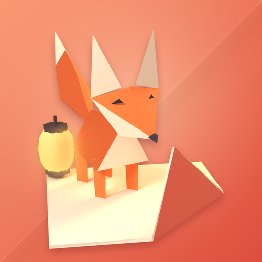
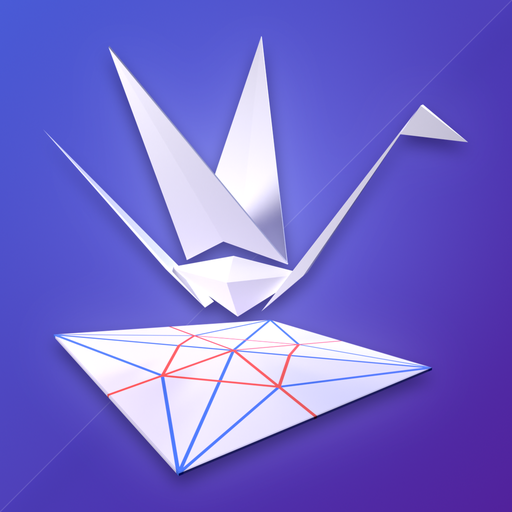
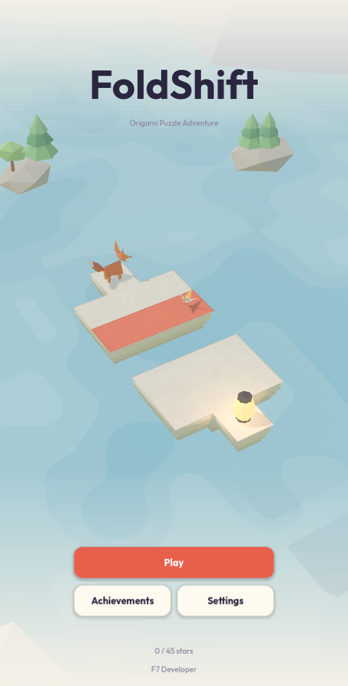
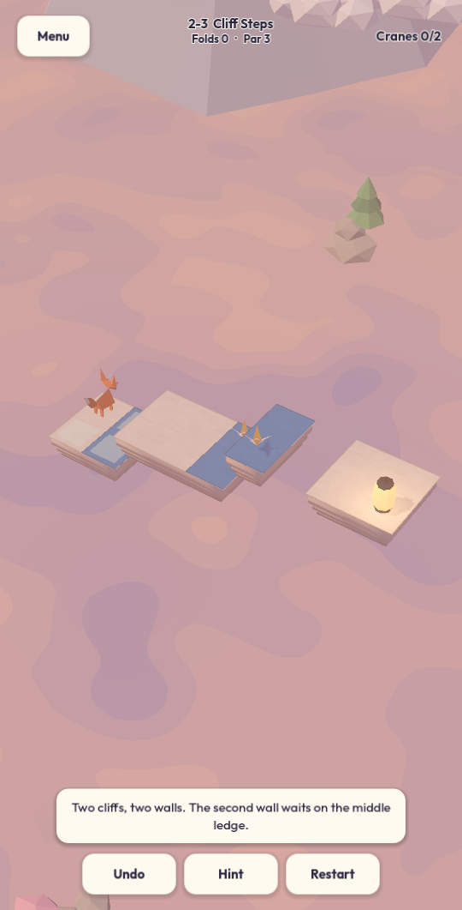
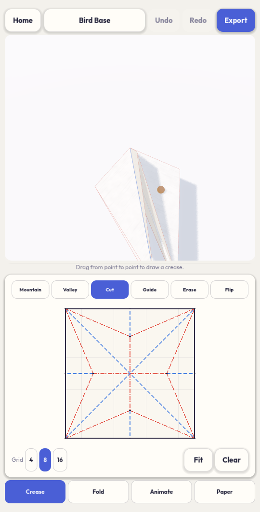
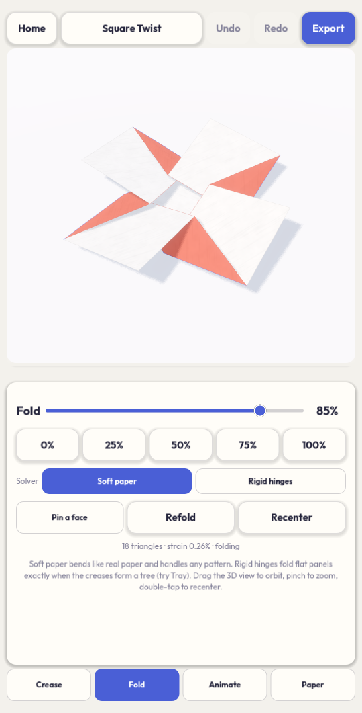
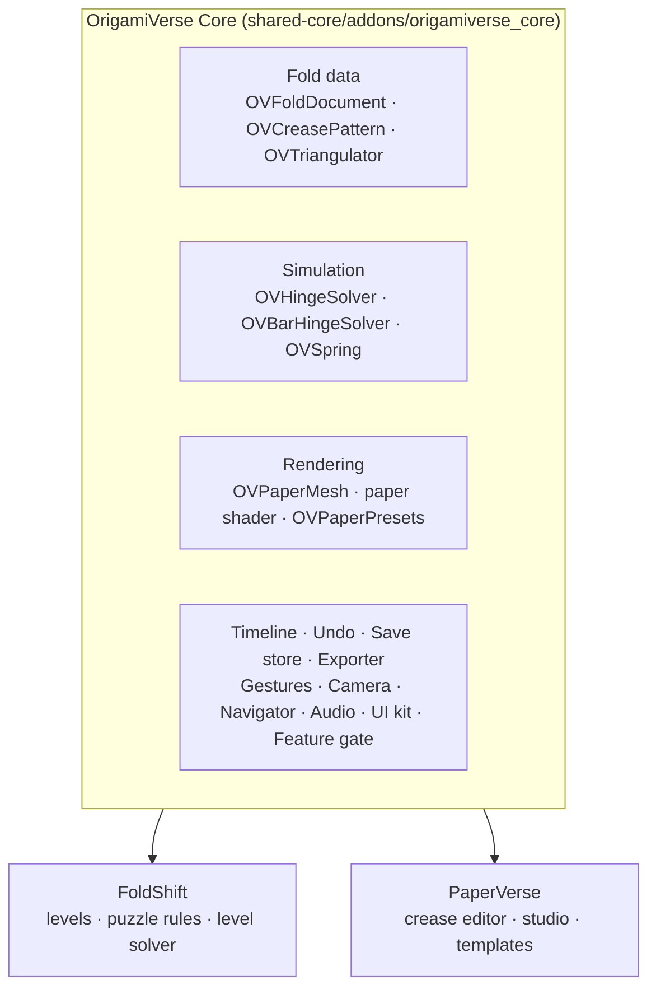

<div align="center">

# OrigamiVerse: Fold Reality

**One origami engine, two Android apps.** Paper folds in real time, simulated on the phone, in a puzzle game and in a creative studio.

[](https://godotengine.org)
[](#build-for-android)
[](#privacy)
[](#built-with-kiro)
[](LICENSE)

by **F7 Developer**

</div>

---

OrigamiVerse is a Kiroween 2026 **Skeleton Crew** entry. The skeleton is **OrigamiVerse Core**, a Godot 4 addon
that loads FOLD files, simulates folding paper on a phone CPU, renders it, and handles saves, undo, audio, input and UI.
Two different apps are built on it:

<table>
<tr>
<td width="50%" valign="top">

###  FoldShift: Origami Puzzle

A 3D puzzle adventure. Kami, a small paper fox, crosses floating paper islands. You fold the world itself: flaps
swing on real hinges to become bridges, walls Kami can walk up, and covers that hide paper cranes.

`com.f7developer.foldshift`

</td>
<td width="50%" valign="top">

###  PaperVerse: 3D Origami Studio

A pocket origami lab. Draw a crease pattern with your finger, watch it fold in 3D live, animate it, dress it in
paper, and export it to FOLD, GLB or OBJ.

`com.f7developer.paperverse`

</td>
</tr>
</table>

<p align="center">
  
  
  
  
</p>

## Highlights

- **Real-time folding, never prerecorded.** Every fold you see is computed by the core solvers each frame.
- **Solver-proven levels.** Every FoldShift level is solved by an automated breadth-first solver in the test suite,
  and each par is the solver's minimum fold count, not a guess.
- **Phone-friendly physics.** The compliant solver reformulates Origami Simulator's bar-and-hinge model as XPBD, so it
  converges in about 12 iterations per frame on a mid-range phone CPU. No compute shaders, so it also runs on the
  OpenGL ES 3 fallback.
- **Offline and private.** No account, no server, no ads, no analytics. Saves stay on the device.
- **One core, zero copies of app code.** The core never references an app. A sync tool and drift check keep each
  app's copy identical to the source.

## FoldShift: Origami Puzzle

- Drag a flap and it rotates about its hinge under your finger, then springs to the nearest allowed angle.
- Tap a tile and Kami walks there. Gravity follows the paper: Kami walks up concave folds and over ledges, and rides
  a flap while it folds.
- Puzzle elements: bridges, walls and ledges, paper cranes printed on the back of flaps, colored wax seals that unlock
  matching flaps, and a paper lantern as the goal.
- 15 levels in 3 chapters: *Paper Meadow* (bridges and hidden cranes), *Lantern Cliffs* (walls you can walk on) and
  *Ink Hollow* (wax seals under a Kiroween moon).
- Stars against par (45 in total), 13 achievements, unlimited undo, hints, and resume mid-level.
- Synthesized paper sound effects and ambience, haptics on fold snap. No audio files ship in the APK.

## PaperVerse: 3D Origami Studio

- Crease editor with Mountain, Valley, Cut, Guide, Erase and Flip tools, a 4/8/16 grid, and snapping to vertices,
  midpoints, intersections and 22.5° angles.
- Two solvers: **Soft paper** (compliant bar-and-hinge, handles any pattern, shows strain live) and **Rigid hinges**
  (exact folding for tree-shaped patterns, with an explanation when a pattern is not rigid-foldable).
- 15 templates: 6 procedural ones (Blank, Half Fold, Accordion Fan, Kite Base, Miura-ori, Tray) and 9 classics
  converted from the MIT-licensed Origami Simulator examples (bird, frog, waterbomb, square and pinwheel bases, square
  twist and more).
- Timeline with keyframed *fold* and *spin* channels, per-key easing, play, loop and scrub.
- Paper presets and custom front and back colors.
- Full undo and redo, autosaved projects with thumbnails, and import of any FOLD file.
- Export to FOLD (crease pattern plus folded frame), GLB, OBJ and PNG through the system save dialog.

## Architecture



| Area | Core classes |
| --- | --- |
| Fold data | `OVFoldDocument` (FOLD 1.2), `OVCreasePattern`, `OVTriangulator` |
| Simulation | `OVHingeSolver` (rigid panels), `OVBarHingeSolver` (compliant XPBD), `OVSpring` |
| Rendering | `OVPaperMesh`, `OVPaperPresets`, paper shader |
| Animation and editing | `OVTimeline`, `OVUndoStack` |
| IO | `OVExporter` (FOLD, OBJ, GLB), `OVSaveStore` (atomic writes, backup, schema version) |
| Input, camera, world | `OVGestureTracker`, `OVOrbitCamera`, `OVCollisionSync`, `OVSurfaceNavigator` |
| Audio and UI | `OVPaperAudio` (synthesized), `OVThemeFactory`, `OVUiKit` |
| Product | `OVFeatureGate` (entitlement checks; everything is unlocked today) |
| Testing | `OVTestCase`, `OVTestRunner` (headless, exit code = number of failures) |

[docs/reusability.md](docs/reusability.md) shows how each app uses the core and how to add a third app.

## Repository layout

```
.kiro/                      Kiro specs, steering and hooks (part of the deliverable)
shared-core/                Godot project that hosts and tests OrigamiVerse Core
  addons/origamiverse_core/ the shared engine (source of truth)
  tests/                    headless core tests
apps/foldshift/             FoldShift Godot project (levels/, scripts/, tests/)
apps/paperverse/            PaperVerse Godot project (templates/, scripts/, tests/)
pipeline/blender/           Blender scripts that generate the low-poly GLB props and icon renders
store/<app>/                Google Play listing assets
docs/                       Kiro usage, reusability, privacy policy, README images
tools/                      sync_core.py, build_android.ps1, icon and template converters
```

> [!IMPORTANT]
> `apps/*/addons/origamiverse_core/` are generated copies. Edit the core only in `shared-core/addons/origamiverse_core/`
> and run `python tools/sync_core.py`.

## Getting started

Requirements: [Godot 4.7](https://godotengine.org/download) and Python 3. Android builds also need the Android SDK and
JDK 17 configured in Godot's editor settings.

```sh
git clone https://github.com/fareza777/origamiverse-kiro.git
cd origamiverse-kiro
```

Open `apps/foldshift/project.godot` or `apps/paperverse/project.godot` in Godot and press **Play**. Each app opens
standalone because its copy of the core is committed.

### Run the tests

```sh
# Core: 51 tests (solvers, FOLD IO, rendering, timeline, undo, saves, navigation, audio, gestures)
godot --headless --path shared-core -s res://tests/run_tests.gd

# FoldShift: solves every level, checks par against the level file, replays the solution through the puzzle rules
godot --headless --path apps/foldshift -s res://tests/run_tests.gd

# PaperVerse: every template planarizes and folds under the strain limit, projects round-trip
godot --headless --path apps/paperverse -s res://tests/run_tests.gd
```

### Keep the core in sync

```sh
python tools/sync_core.py          # copy the core into every app
python tools/sync_core.py --check  # exit 1 if any app copy drifted
```

### Build for Android

```powershell
powershell -File tools/build_android.ps1 -App all        # signed APK + AAB per app into build/<app>/
powershell -File tools/build_android.ps1 -App foldshift -Install
```

The script refuses to build if the core copies drifted. Signing credentials come from the
`GODOT_ANDROID_KEYSTORE_RELEASE_PATH`, `GODOT_ANDROID_KEYSTORE_RELEASE_USER` and
`GODOT_ANDROID_KEYSTORE_RELEASE_PASSWORD` environment variables. Keystores are never committed.

### Regenerate assets

All 3D props are generated from code in Blender, with no third-party meshes or textures. Blender is a build-time tool
only and nothing from it runs inside the APKs.

```sh
blender --background --factory-startup --python pipeline/blender/build_assets.py -- <out_dir>
blender --background --factory-startup --python pipeline/blender/render_icons.py -- <models_dir> <out_dir>
python tools/compose_icons.py
```

## Built with Kiro

The whole project was built spec-first with [Kiro](https://kiro.dev). Everything Kiro used is tracked in `.kiro/`:

- **Specs:** `origamiverse-core`, `foldshift` and `paperverse`, each with `requirements.md` (EARS-style acceptance
  criteria), `design.md` and `tasks.md`. The core spec came first, so both app specs build on its classes.
- **Steering:** product non-negotiables, toolchain and performance rules, and the repository layout.
- **Hooks:** sync the core when a core file is saved, run the core tests after core changes, and re-run the level
  proofs when FoldShift levels change.

Details are in [docs/kiro-usage.md](docs/kiro-usage.md).

## Privacy

Neither app collects personal data. There is no sign-in, no analytics and no network traffic. Progress and projects
live only in the app's private storage. See the [privacy policy](docs/privacy-policy.md).

## Credits

OrigamiVerse Core learns from these MIT-licensed projects. No code was copied; the parser and solvers are written in
GDScript.

- [edemaine/fold](https://github.com/edemaine/fold): the FOLD 1.2 file format and data model.
- [amandaghassaei/OrigamiSimulator](https://github.com/amandaghassaei/OrigamiSimulator): the bar-and-hinge model, and
  the example crease patterns converted into PaperVerse templates by `tools/svg_to_templates.py`.
- [ELF32bit/godot-folder](https://github.com/ELF32bit/godot-folder): the idea of a FOLD graph class that builds meshes
  in Godot.

The UI font is Outfit, licensed under the SIL Open Font License (`shared-core/addons/origamiverse_core/ui/fonts/OFL.txt`).
Full copyright notices are in [THIRD_PARTY_NOTICES.md](THIRD_PARTY_NOTICES.md).

## License

[MIT](LICENSE) © 2026 F7 Developer
